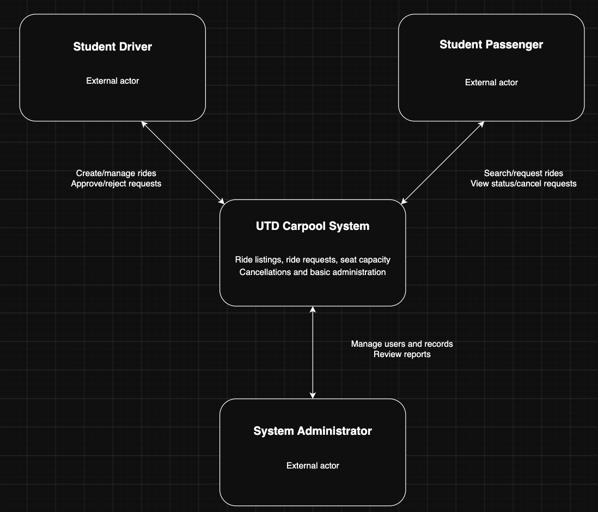
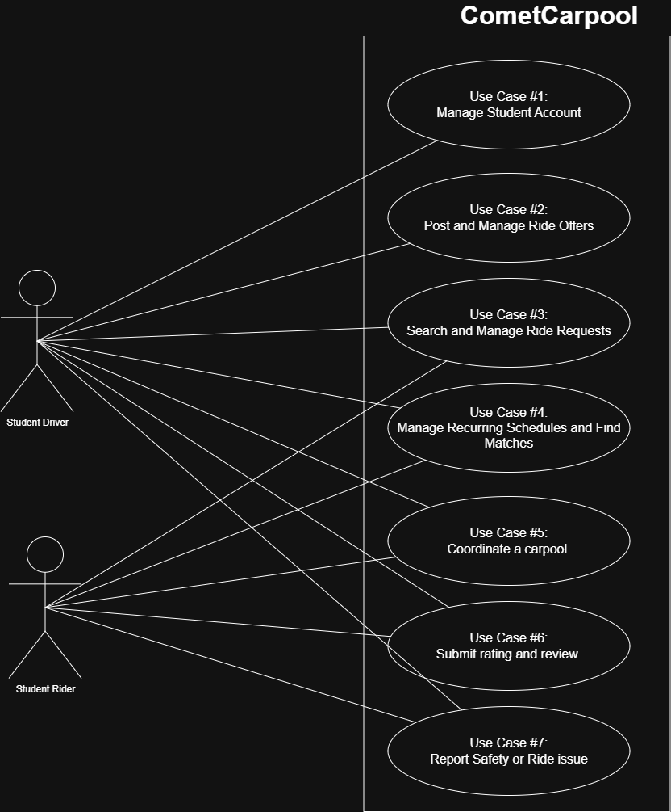

**CE / CS / SE 3354 · SOFTWARE ENGINEERING · FALL 2026**

# Project Deliverable P1

## Proposal and Requirements — Team Template

Weight 4% · Due Sunday 18 October 2026, 11:59 PM Central · Submit one PDF per team on Canvas

<table>
<colgroup>
<col style="width: 27%" />
<col style="width: 72%" />
</colgroup>
<thead style="text-align: left;">
<tr class="header">
<th style="text-align: left;"><strong>Field</strong></th>
<th style="text-align: left;"><strong>Your entry</strong></th>
</tr>
</thead>
<tbody>
<tr class="odd">
<td>Project title</td>
<td>Comet Carpool</td>
</tr>
<tr class="even">
<td>Team number and section</td>
<td>Team 8 – SE/CE/CS 3354.003</td>
</tr>
<tr class="odd">
<td>Team members (name · net ID)</td>
<td>Hunter Treleaven – DAL858914 | Herbert Melgar – HRM230005 | Anish Agarwal – AXA210116 | Dian Chen – DXC220044 | Dmytro Vasyliuk – DXV230035 | Aayush Srivastava – AXS230414</td>
</tr>
<tr class="even">
<td>Repository URL</td>
<td>
<strong>Repository:</strong> <a href="https://github.com/htreleaventx/CometCarpool/">https://github.com/htreleaventx/CometCarpool/</a>

<strong>Project Board:</strong> <a href="https://github.com/users/htreleaventx/projects/1">https://github.com/users/htreleaventx/projects/1</a>
</td>
</tr>
<tr class="odd">
<td>Document version</td>
<td>0.1</td>
</tr>
<tr class="even">
<td>Date</td>
<td>October 18, 2026</td>
</tr>
</tbody>
</table>

## 0 Revision History and Contribution Record

Both tables below are graded. The contribution record carries the individual 20% of this milestone and must be consistent with your repository history.

| **Version** | **Date**     | **Author**                           | **Summary of change**                                                          |
| :--- | :--- | :--- | :--- |
| 0.1         | Oct 15, 2026 | Hunter, Herbert, Anish, Dmytro, Dian | Initial baseline for P1, including document sections with answers to template. |

### 0.1 Individual contribution record

| **Team member**   | **What this person produced for P1**                                                                                                                                                                               | **Evidence in the repository**                       |
| :--- | :--- | :--- |
| Hunter Treleaven  | Created the initial P1 repository structure and documentation folders. Completed Sections 1.1–1.4, 3.1–3.3, and 4.4. Updated stakeholder IDs, requirement sources, and the Section 3.5 traceability documentation. | Commits: c7f78db, 55e1b5f, f75fd00, 144bfd6, 82d30ac |
| Dmytro Vasyliuk   | Completed Sections 2.1–2.6, including the overall description, stakeholders, constraints, assumptions, and feasibility summary.                                                                                    | Commits: 863e928, b0024c4, 3764645                   |
| Herbert Melgar    | Completed Sections 3.4–3.5, including the use cases and requirements traceability matrix. Completed Section 4.3 project risks and contributed to Section 4.5 AI declaration.                                       | Commits: 0d4597a, edfcfa0, a305907, ca60e7a          |
| Anish Agarwal     | Completed Sections 4.1 and 4.2, including the team roles and working agreement and the plan to P2.                                                                                                                 | Commits: 3d5c275                                     |
| Dian Chen         | Completed Section 5 Open Questions and updated the Section 5 documentation.                                                                                                                                        | Commits: 5560cf1, ed5d591                            |
| Aayush Srivastava | Did not contribute to P1                                                                                                                                                                                           | No repo evidence                                     |

## 1 Introduction

### 1.1 Purpose of this document and of the system

<table>
<colgroup>
<col style="width: 100%" />
</colgroup>
<tbody>
<tr class="odd">
<td>
This document will define our initial scope, requirements, stakeholders, and goals for the Comet Carpool System. It is intended for Professor Seker and any other stakeholders that may be involved in evaluating or developing the system. This document will provide a baseline that will help guide future design and development decisions while working on the project.

Comet Carpool will be designed to help students at the University of Texas at Dallas connect with other students who can offer or post ride requests. The system can be used for trips to and from campus as well as trips to other places around Dallas such as stores, airports, restaurants or various destinations. The purpose is to make transportation more accessible and convenient for students by allowing them to coordinate rides with other students in the UTD community.
</td>
</tr>
</tbody>
</table>

### 1.2 Scope

| **In scope — we will build this**                                                                                   | **Out of scope — we will not, and why**                                                                                                                                  |
| :--- | :--- |
| Allow students to create and manage user accounts                                                                   | Public access for users outside the UTD community so we can keep the system focused on UTD students and their safety                                                     |
| Allow drivers to post available rides                                                                               | Process or transfer payments between riders and drivers because transactions could add unnecessary complexity                                                            |
| Allow riders to post ride requests                                                                                  | Background checks or ID verification beyond because this would require external services and additional access to personal information                                   |
| Allow users to search for available rides and ride requests                                                         | Real time GPS tracking on drivers or riders because this would create privacy and safety concerns                                                                        |
| Allow users to enter trip details like pick up location, final location, date and time                              | Integration with other ride share services because the project is focused on keeping UTD students connected                                                              |
| Allow riders and drivers to connect and coordinate rides                                                            | Route optimization or navigation because its not part of our systems main purpose and can be handled by personal knowledge or other map applications                     |
| Allow users to cancel posted rides or ride requests                                                                 | Provide reason for cancel because it may be because of safety or an out of control situation that just happened                                                          |
| Allow riders and drivers to agree to split travel costs                                                             | Enforcing payment agreements or resolving payment disputes because this isn’t a financial dispute or resolution service                                                  |
| Allow rides to and from UTD as well as other trips to other locations around Dallas                                 | Guaranteeing a ride will be available for every request because ride availability depends on the drivers offering a ride                                                 |
| Allow users to enter the days and times they’re normally on UTD campus to help find students with similar schedules | Collecting specific class names, sections, buildings, or classrooms because this information isn’t necessary and could create privacy and safety concerns                |
| Allow drivers to specify which days of the week and times they’re available to provide rides                        | Accessing or importing a students class schedule because this would require access to external systems and additional permissions                                        |
| Allow riders to specify the days and times they need transportation regularly                                       | Tracking a users location while they are on campus because the system only needs general availability                                                                    |
| Allow users to search or be matched with riders and drivers who have similar schedules                              | Guaranteeing users with similar schedules would be matched because they may not always be available                                                                      |
| Allow riders and drivers to connect through in app system                                                           | Providing phone numbers to users unless they share themselves because this can be a privacy or safety concern                                                            |
| Allow riders and drivers to leave reviews and ratings for one another after a ride                                  | Manually investigating or resolving disputes about reviews because it will not act as a formal moderation service                                                        |
| Allow users to report another user, review, or ride related issues for inappropriate behavior or safety concerns    | Formal investigation or resolution of disputes between users because it will allow the submission of reports but won’t function as a legal or formal resolution service. |

<table>
<colgroup>
<col style="width: 100%" />
</colgroup>
<tbody>
<tr class="odd">
<td>
<em>Why the exclusions were excluded:</em>

The excluded features were left out so we could keep Comet Carpool focused on its main purpose of helping students coordinate rides without having unnecessary technical, legal, or privacy/safety concerns. Some features such as payment processing, GPS tracking, background checks, class schedule importing, and 3rd part integrations could require additional permissions, systems, or resources that are outside the scope of our initial project.
</td>
</tr>
</tbody>
</table>

### 1.3 Definitions, acronyms and abbreviations

| **Term or abbreviation** | **Meaning as used in this project**                                                                                  |
| :--- | :--- |
| UTD                      | The University of Texas at Dallas                                                                                    |
| Comet Carpool            | The coordination system being developed for students                                                                 |
| Driver                   | A student who offers transportation to another student                                                               |
| Rider                    | A student who requests or joins a ride offered by a driver                                                           |
| Ride Request             | A request posted by a rider saying when and where a ride is needed                                                   |
| Available Ride           | A ride posted by a driver showing that they’re available to give a ride to another student                           |
| Carpool                  | A shared ride between two or more people in one vehicle                                                              |
| Recurring Schedule       | A repeated weekly schedule showing the days and times a user would normally need or provide a ride                   |
| Ride Match               | A connection between a rider and driver who’s ride needs, location and/or schedule are a match/compatible            |
| In App Messaging (IAM)   | A communication feature that allows riders and drivers to coordinate a ride                                          |
| Rating                   | A score a rider or driver can leave for one another after a completed ride                                           |
| Review                   | A message or excerpt left by a rider or driver about another user after a completed ride                             |
| Report                   | A submission made by a user to flag another user, review, or issue for safety or inappropriate behavior              |
| Travel Cost Split (TCS)  | An agreement between riders and drivers to share costs such as gas but the system doesn’t process the payment itself |

### 1.4 References

<table>
<colgroup>
<col style="width: 100%" />
</colgroup>
<tbody>
<tr class="odd">
<td>
[R1] – The University of Texas at Dallas website

[R2] – Comet Carpool Team Discussions

[R3] – UTD app where students post ride requests or offer rides (more clutter to this system and anything can be posted not just for transportation)
</td>
</tr>
</tbody>
</table>

## 2 Overall Description

### 2.1 Product perspective and context

The CometCarpool system is a web application designed to connect UT Dallas students offering rides with students seeking transportation. The system’s scope includes creating and managing ride lists, searching for available rides, submitting and reviewing ride requests, managing seat availability, handling cancellations, and basic administrative functions. Student drivers, student passengers, and system administrators interact with the system as external participants. The system does not include real-time GPS tracking, route optimization, payment processing, or integration with external ridesharing platforms. No university authentication service or other third-party integration is planned at this stage, allowing the team to focus on core functionality without relying on unverified external services.

### 2.2 Stakeholders and how you reached them

| **Stakeholder**                            | **Role in relation to the system**                                                                                                      | **What they need from it**                                                                                                                                                          | **How you learned this**                                                                       |
| :--- | :--- | :--- | :--- |
| \[S1\] Student driver                      | A university student who offers available seats in their vehicle to other students                                                      | Simple way to create rides, manage available seats, approve ride requests                                                                                                           | Assumed for P1 based on the proposed carpool workflow                                          |
| \[S2\] Student passenger                   | An university student who is looking for transportation and wants to join an available ride                                             | Simple way to find available rides, request to join rides, manage ride requests                                                                                                     | Assumed for P1 based on the proposed carpool workflow                                          |
| \[S3\] System Administrator                | A person responsible for basic management and moderation of the system                                                                  | The ability to manage user accounts, review reported activity, and maintain basic control over the system data                                                                      | Assumed for P1 based on the need for basic system administration and moderation                |
| \[S4\] UTD Transportation/Parking Services | An indirect stakeholder that may be affected by student transportation and parking demand, but does not need to use the system directly | A system that encourages ride sharing without interfering with university transportation policies and that may help reduce number of individual traveling vehicles to campus        | Assumed for P1 based on the expected effect of carpooling on campus transportation and parking |
| \[S5\] Project development team            | The team responsible for developing, maintaining, and testing the Carpool System during the course project                              | Clearly defined requirements, a manageable project scope, maintainable implementation, and features that can be divided among team members and completed within the course schedule | Identified through team planning and the course project requirements                           |

### 2.3 User characteristics

<table>
<colgroup>
<col style="width: 100%" />
</colgroup>
<tbody>
<tr class="odd">
<td>
<strong>Student drivers</strong> - university students who have access to a vehicle and are willing to offer available seats to other students. They are expected to have basic experience using common web or mobile applications, but the system does not require advanced technical knowledge. Drivers may access the system from either a smartphone or a computer and may need to create or update ride information quickly before traveling. Therefore, the interface should make common actions easy to understand and complete.

<strong>Student passengers</strong> - university students who are looking for transportation to or from campus or other agreed destinations. They are expected to be familiar with basic web or mobile applications, but they should not need advanced technical knowledge to use the system. Passengers may often use the system from a smartphone and may need to find a suitable ride quickly based on location, date, and departure time. Ride information and request status should therefore be presented clearly.

<strong>System administrators</strong> - users responsible for basic system management and moderation. They are expected to have a higher level of familiarity with the application than regular users, but they should not need programming or database knowledge to perform administrative tasks. Administrators are more likely to use the system from desktop or laptop computer when reviewing user accounts, reports, or other system information.
</td>
</tr>
</tbody>
</table>

### 2.4 Constraints

<table>
<colgroup>
<col style="width: 100%" />
</colgroup>
<tbody>
<tr class="odd">
<td><ol type="1">
<li>
<strong>User eligibility constraint</strong>
</li>
</ol>

Access to Comet Carpool will be limited to verified members of the UTD community.

<strong>Source:</strong> S1, S2, R2

<ol start="2" type="1">
<li>
<strong>Payment processing constraint</strong>
</li>
</ol>

Comet Carpool will not process, store, or transfer payments between riders and drivers.

<strong>Source:</strong> S1, S2, R2

<ol start="3" type="1">
<li>
<strong>Real-time GPS constraint</strong>
</li>
</ol>

Comet Carpool will not provide real-time GPS tracking of riders or drivers.

<strong>Source:</strong> S1, S2, R2

<ol start="4" type="1">
<li>
<strong>Class schedule integration constraint</strong>
</li>
</ol>

Comet Carpool will not automatically import a student's official UTD class schedule.

<strong>Source:</strong> S1, S2, R2
</td>
</tr>
</tbody>
</table>

### 2.5 Assumptions and dependencies

| **\#** | **Assumption or dependency**                                                                                                                                                                                              | **What breaks if it does not hold**                                                                                                                                                             |
| :--- | :--- | :--- |
| A1     | A sufficient number of students will be willing to offer and request rides with compatible routes and schedules                                                                                                           | If student participation is too low, passengers may be unable to find suitable rides, significantly reducing the system's usefulness                                                            |
| A2     | University-issued email addresses will be sufficient to verify users' eligibility without requiring integration with university authentication systems                                                                    | If email verification is insufficient, additional identity verification methods or university system integration may be required, increasing project complexity and development time            |
| A3     | We assume that students will be able to coordinate carpools effectively using predefined pickup locations, destinations, and departure times without requiring real-time vehicle tracking or automatic route optimization | If students require real-time coordination or more flexible route planning, the proposed functionality may be insufficient, requiring additional features and increasing development complexity |

### 2.6 Feasibility summary

| **Feasibility gate** | **Verdict**                       | **Evidence behind the verdict**                                                                                                                                                                                                                                                                                                                                      |
| :--- | :--- | :--- |
| Technical            | Feasible with minor risks         | The system's core functionality involves common web development concepts such as user authentication, database management, and ride scheduling. However, the team does not have a dedicated frontend developer, which may increase development difficulty and require additional time to get familiar with frontend technologies.                                    |
| Operational          | Feasible, pending user validation | The existing Ride Sharing section in the UTD application demonstrates that students already have a way to coordinate shared transportation. The proposed system would provide a more structured process for offering rides, searching for available transportation, and managing ride requests. Actual user interest in a separate platform remains to be validated. |
| Schedule             | Feasible, currently on track      | The course establishes three milestones: P1 (October 18), P2 (November 8), and P3 (December 9). The team has divided documentation responsibilities among members and is working toward the first milestone. The defined deadlines provide a framework for tracking progress throughout development.                                                                 |
| Economic / resource  | Feasible with current resources   | The team already has access to a shared GitHub repository and personal computers for development. The planned core features do not inherently require paid third-party services. Free development tools can be used, while hosting and deployment requirements will need to be confirmed.                                                                            |

## 3 Specific Requirements

### 3.1 Functional requirements

| **ID** | **Requirement — one “shall” sentence**                                                                                    | **Priority** | **Source**     | **Acceptance criterion**                                                                                                |
| :--- | :--- | :--- | :--- | :--- |
| FR-01  | The system shall allow a UTD student to create a CometCarpool user account                                                | MUST         | S1, S2, R2     | A tester can create a new account using valid student information and successfully access the system                    |
| FR-02  | The system shall allow a user to update their account info                                                                | SHOULD       | S1, S2, R2     | A tester can edit an allowed profile field, save it, and see the value updated after refreshing the profile             |
| FR-03  | The system shall allow a driver to post an available ride                                                                 | MUST         | S1, R2, R3     | A tester acting as a driver can create a ride post and see it listed as available                                       |
| FR-04  | The system shall allow a rider to post a ride request                                                                     | MUST         | S2, R2, R3     | A tester acting as a rider can create a ride request and see it listed for drivers                                      |
| FR-05  | The system shall allow a user to include pick up location, final location, date and time for a ride or ride request       | MUST         | S1, S2, R2     | A tester can enter all trip details and confirm they appear correctly on the posting                                    |
| FR-06  | The system shall allow a users to search for available rides and ride requests                                            | MUST         | S1, S2, R2     | A tester can preform a search and view posting that satisfies the search criteria that is entered                       |
| FR-07  | The system shall allow drivers to record the days and times they are regularly available to drive                         | SHOULD       | S1, R2         | A driver can save recurring availability for select days/times and view it after saving                                 |
| FR-08  | The system shall allow riders to record the days and times they regularly need transportation                             | SHOULD       | S2, R2         | A rider can save recurring transportation needs for select days/times and view it after saving                          |
| FR-09  | The system shall allow users to identify riders or drivers with compatible recurring schedules                            | SHOULD       | S1, S2, R2     | A tester can enter compatible schedules for two users and confirm that the system identifies them as a potential match  |
| FR-10  | The system shall allow a rider and driver to exchange messages through an In App Messaging system                         | MUST         | S1, S2, R2     | Two test accounts can send and recieve messages within the system and each other                                        |
| FR-11  | The system shall allow a user to cancel a posted ride or ride request                                                     | MUST         | S1, S2, R2     | A tester can cancel an active posting and confirm that it is no longer shown as available                               |
| FR-12  | The system shall allow riders and drivers to indicate an agreement to split travel costs                                  | COULD        | S1, S2, R2     | A tester can indicate that travel costs will be shared and see that agreement associated with the ride                  |
| FR-13  | The system shall allow riders and drivers to submit a rating and review for one another                                   | SHOULD       | S1, S2, R2     | After completing a ride a tester can submit a rating and written review for the opposing user                           |
| FR-14  | The system shall allow a user to report another user, review, or ride related issues                                      | MUST         | S1, S2, S3, R2 | A tester can submit a report containing a selected issue and description and recieve confirmation that it was submitted |
| FR-15  | The system shall allow users to create rides with destinations both on the UTD campus and surrounding areas around Dallas | MUST         | S1, S2, R2     | A tester can create one ride to UTD and another ride to Dallas destination and save both successfully                   |

### 3.2 Quality requirements

| **ID** | **Requirement — with threshold, condition and method**                                                                                                                                                    | **Priority** | **Source**         | **How it will be verified**                                                                                                                             |
| :--- | :--- | :--- | :--- | :--- |
| QR-01  | Atleast 95% of ride and ride requests shall return results within 2 seconds under a normal load of up to 50 concurring users                                                                              | MUST         | S1, S2, R2         | Measure response time of 100 search requests under simulated normal load and confirm atleast 95 return within 2 seconds                                 |
| QR-02  | Atleast 95% of in app messages shall be delivered to the intended recipient within 3 seconds while both users have an active internet/data connection                                                     | MUST         | S1, S2, R2         | Send 100 test messages between two active accounts and record delivery times                                                                            |
| QR-03  | Our system shall successfully save atleast 99% of valid ride postings, ride requests, reviews, reports and recurring schedule updates during normal operation                                             | MUST         | S1, S2, S3, S5, R2 | Submit 100 valid save operations across the features and confirm atleast 99 are stored successfully                                                     |
| QR-04  | A new user shall be able to complete the process of posting a ride or ride request within 3 minutes without outside assistance after logging in                                                           | SHOULD       | S1, S2, R2         | Observe atleast 5 first time test users and record whether they can complete the task within 3 minutes without help                                     |
| QR-05  | The system shall require authentication before allowing access to private account information, in app messaging, reviews, reports, or recurring schedule information in 100% of unauthorized access tests | MUST         | S1, S2, S3, R2     | Attempt to access each protected feature while logged out and confirm access is denied in each test                                                     |
| QR-06  | The system shall display correctly without horizontal scrolling on screens widths of 375 pixels or greater for all primary user pages                                                                     | SHOULD       | S1, S2, R2         | Test the primary pages at 375px, tablet width, and desktop width and confirm that the required content is readable without needing horizontal scrolling |

### 3.3 Constraint requirements

| **ID** | **Constraint — one sentence**                                                                | **Source** | **Why it cannot be negotiated**                                                                                                        |
| :--- | :--- | :--- | :--- |
| CON-01 | The system shall restrict account creation and system access to members of the UTD community | S1, S2, R2 | CometCarpool is specifically intended for UTD students, so unrestricted public access would change our defined scope and target users  |
| CON-02 | The system shall not process, store, or transfer payments between riders and drivers         | S1, S2, R2 | Payment processing was excluded from the project scope because it introduces additional finances, security, and legal responsibilities |
| CON-03 | The system shall not provide real time GPS tracking of riders or drivers                     | S1, S2, R2 | Real time tracking was excluded because of privacy, safety, and implementation concerns                                                |
| CON-04 | The system shall not automatically import a students official class schedule                 | S1, S2, R2 | Accessing official class schedules would require external systems and permissions that are outside the project scope                   |

### 3.4 Initial use cases

#### Expanded use case — copy this block for each of your two

<table>
<colgroup>
<col style="width: 23%" />
<col style="width: 76%" />
</colgroup>
<thead style="text-align: left;">
<tr class="header">
<th style="text-align: left;"><strong>Field</strong></th>
<th style="text-align: left;"><strong>Content</strong></th>
</tr>
</thead>
<tbody>
<tr class="odd">
<td>Identifier and name</td>
<td>UC-03: Search and Manage Ride Requests</td>
</tr>
<tr class="even">
<td>Primary actor</td>
<td>Student Rider</td>
</tr>
<tr class="odd">
<td>Supporting actors</td>
<td>Student Driver ( whose responding to a posted request)</td>
</tr>
<tr class="even">
<td>Preconditions — what must be true before it starts</td>
<td>The student rider must have an active CometCarpool account and be logged into that system.</td>
</tr>
<tr class="odd">
<td>Trigger — what starts it</td>
<td>The Student Rider opens ride search / ride request feature from the portal to find the transportation feature.</td>
</tr>
<tr class="even">
<td>Main success scenario — numbered steps</td>
<td><ol type="1">
<li>
The Student Rider opens the ride search feature in the CometCarpool.
</li>
<li>
Then, the system displays the ride search feature interface.
</li>
<li>
The Student Rider enters their desired pickup location, destination, time, etc.
</li>
<li>
The system searches for available rides matching the entered criteria.
</li>
<li>
The system displays the available rides to the student rider.
</li>
<li>
The student rider reviews the available ride options and decides to create their own ride request.
</li>
<li>
The student rider enters the required pickup location, destination, date, time and submits the ride request
</li>
<li>
The system saves the request and make it available to eligible drivers
</li>
<li>
The system confirms the ride request was posted
</li>
</ol></td>
</tr>
<tr class="odd">
<td>Alternative and exception flows</td>
<td>
A1- No matching rides: at step5, if no rides match the criteria, the system informs the rider that no matching rides were found. The rider may continue by creating a ride request.

A2- Request cancellation: after posting a request, the rider may cancel it. the system updates the request status and removes it from the available requests.
</td>
</tr>
<tr class="even">
<td>Postconditions — what is true when it succeeds</td>
<td>the student riders ride request is successfully saved in CometCarpool, becomes visible to eligible drivers, and the Student Rider receives confirmation that the request was posted.</td>
</tr>
<tr class="odd">
<td>Requirements realised</td>
<td>FR-04, FR-05, FR-06, FR-11</td>
</tr>
</tbody>
</table>

<table>
<colgroup>
<col style="width: 23%" />
<col style="width: 76%" />
</colgroup>
<thead style="text-align: left;">
<tr class="header">
<th style="text-align: left;"><strong>Field</strong></th>
<th style="text-align: left;"><strong>Content</strong></th>
</tr>
</thead>
<tbody>
<tr class="odd">
<td>Identifier and name</td>
<td>UC-04: Manage Recurring Schedules and Find Matches</td>
</tr>
<tr class="even">
<td>Primary actor</td>
<td>Student Rider</td>
</tr>
<tr class="odd">
<td>Supporting actors</td>
<td>Student Driver (provides recurring availability that could match the rider's transportation needs at that time)</td>
</tr>
<tr class="even">
<td>Preconditions — what must be true before it starts</td>
<td>The student rider must have an active CometCarpool account, be a verified member of the UTD community, and be logged into the system. Student Drivers must have entered their recurring availability for the system to ID potential matches.</td>
</tr>
<tr class="odd">
<td>Trigger — what starts it</td>
<td>The student rider opens the recurring schedule feature to enter their weekly transportation needs. The system then finds students with compatible schedules.</td>
</tr>
<tr class="even">
<td>Main success scenario — numbered steps</td>
<td><ol type="1">
<li>
The student rider opens the recurring schedule in CometCarpool
</li>
<li>
the system displays the recurring schedule interface
</li>
<li>
the student rider selects the days of the week and the times they would regularly need a ride
</li>
<li>
the student rider saves their schedule
</li>
<li>
the system stores the schedule and confirms it was saved
</li>
<li>
the student rider selects the option to find compatible schedules
</li>
<li>
the system compares the riders needs against the availability entered by the drivers
</li>
<li>
the system displays potential matches with compatible days and times
</li>
<li>
the student rider reviews the potential matches and selects a driver they’d like to coordinate a ride with.
</li>
</ol></td>
</tr>
<tr class="odd">
<td>Alternative and exception flows</td>
<td>
A1- No compatible schedules: at step 8, if no compatible driver schedules are found for a rider, the system will inform them and they may modify their schedule to search again

A2- Missing schedule info: at step 4, if the rider has not selected the required days or times, the system identifies the missing info and requests some corrections before saving.

A3- Driver saves availability: A student driver opens the recurring schedule feature, selects the days and times they can provide transportation, and saves their availability. The system stores the driver's schedule for future matching.
</td>
</tr>
<tr class="even">
<td>Postconditions — what is true when it succeeds</td>
<td>the student rider's recurring transportation schedule is successfully stored in CometCarpool. the system has ID'd and displayed any compatible driver schedules, giving the rider an opportunity to initiate further ride coordination.</td>
</tr>
<tr class="odd">
<td>Requirements realised</td>
<td>FR-07, FR-08, FR-09</td>
</tr>
</tbody>
</table>

### 3.5 Requirements to use case traceability

| **Requirement ID** | **Use case(s) that realise it** | **If blank — why, and what you will do** |
| :--- | :--- | :--- |
| FR-01              | UC-01                           |                                          |
| FR-02              | UC-01                           |                                          |
| FR-03              | UC-02                           |                                          |
| FR-04              | UC-03                           |                                          |
| FR-05              | UC-02, UC-03                    |                                          |
| FR-06              | UC-03                           |                                          |
| FR-07              | UC-04                           |                                          |
| FR-08              | UC-04                           |                                          |
| FR-09              | UC-04                           |                                          |
| FR-10              | UC-05                           |                                          |
| FR-11              | UC-02, UC-03                    |                                          |
| FR-12              | UC-05                           |                                          |
| FR-13              | UC-06                           |                                          |
| FR-14              | UC-07                           |                                          |
| FR-15              | UC-02                           |                                          |

<table>
<colgroup>
<col style="width: 100%" />
</colgroup>
<tbody>
<tr class="odd">
<td>
<em>What the matrix revealed, and what you changed because of it:</em>

After taking some time to review the requirements-to-use case traceability matrix, we confirmed that each of the 15 functional requirements had at least one use case representative. Some FRs, like FR-05 and FR-11, applied to multiple use cases because both drivers and riders need to manage trip information and cancellations. The matrix also confirms all seven uses cases are supported by functional requirements. During the review process, we clarified UC-03 to include searching and managing ride requests. No additional use cases were required based on the current FRs.
</td>
</tr>
</tbody>
</table>

## 4 Project Plan

### 4.1 Team roles and working agreement

| **Team member**                                                                                | **Role for P1 to P2** | **How the team makes a decision when it disagrees**                                               |
| :--- | :--- | :--- |
| Herbert Melgar, Dian Chen                                                                      | Analyst               | Rerunning trials for more evidence                                                                |
| Anish Agarwal, Aayush Srivastava                                                               | Designer              | Compare the proposed designs against the requirements and select the one that best satisfies them |
| Hunter Treleaven, Herbert Melgar, Anish Agarwal, Aayush Srivastava, Dmytro Vasyliuk, Dian Chen | Developer             | Make a quick proof of concept for the options and choose the more effective one                   |
| Hunter Treleaven, Dian Chen, Dmytro Vasyliuk                                                   | Tester                | Bring in Project Manager                                                                          |
| Anish Agarwal                                                                                  | Reviewer              | Accept the reviewer’s assertion                                                                   |
| Hunter Treleaven                                                                               | Project Manager       | Team Vote                                                                                         |

### 4.2 Plan to P2

| **Date**         | **What will be finished**                                                                                                            | **Owner** |
| :--- | :--- | :--- |
| October 22, 2026 | Complete use case analysis and confirm the main system interactions that will guide P2 design work                                   | Herbert   |
| October 24, 2026 | Research and compare possible programming languages, frameworks, databases, and major libraries for Comet Carpool                    | Hunter    |
| October 25, 2026 | Complete the first draft of the target workflow model based on the approved use cases                                                | Dmytro    |
| October 28, 2026 | Revise the target workflow model based on team feedback and identified issues                                                        | Dmytro    |
| October 30, 2026 | Select the proposed technology stack and document the reasoning for the selected language, frameworks, database, and major libraries | Hunter    |
| November 1, 2026 | Complete the first draft of the high-level system architecture                                                                       | Anish     |
| November 4, 2026 | Review the high-level architecture for consistency with requirements, workflows, and the selected technology stack                   | Herbert   |
| November 8, 2026 | Complete the revised high-level architecture and document the rationale for the final architecture decisions                         | Anish     |

### 4.3 Risks

<table>
<colgroup>
<col style="width: 5%" />
<col style="width: 31%" />
<col style="width: 11%" />
<col style="width: 11%" />
<col style="width: 41%" />
</colgroup>
<thead style="text-align: left;">
<tr class="header">
<th style="text-align: left;"><strong>#</strong></th>
<th style="text-align: left;"><strong>Risk</strong></th>
<th style="text-align: left;"><strong>Likelihood</strong></th>
<th style="text-align: left;"><strong>Impact</strong></th>
<th style="text-align: left;"><strong>Mitigation — action and owner</strong></th>
</tr>
</thead>
<tbody>
<tr class="odd">
<td>R1</td>
<td>not enough students participate. Making the demand for rides insufficient and impacting number of rides.</td>
<td>Medium</td>
<td> High</td>
<td>
<strong>Action:</strong> Identify the minimum features needed to make riding as straightforward and easy as possible. Review this idea with commuter students and gather feedback before P2

<strong>Owner:</strong> Herbert Melgar
</td>
</tr>
<tr class="even">
<td>R2</td>
<td>difficulty implementing key features, delaying development.</td>
<td>Medium</td>
<td>High</td>
<td>
<strong>Action:</strong> Identify the features that will be more complicated and will require the most work, first. Possibly complete a feasibility test before development of those features. Overall have a structured plan and schedule for each key feature so we know what feature may take more time and plan accordingly.

<strong>Owner:</strong> Hunter Treleaven
</td>
</tr>
<tr class="odd">
<td>R3</td>
<td>Students may not provide enough information about their pickup location. Likely those who live in apartments and such. This impacts ride coordination and may lead to the cancellation of some rides or users being late.</td>
<td>Medium</td>
<td>Medium</td>
<td>
<strong>Action:</strong> Define location requirements for ride information can also document how students can update or cancel incorrect ride/location details.

<strong>Owner:</strong> Dian Chen
</td>
</tr>
<tr class="even">
<td>R4</td>
<td>Unauthorized users accessing user information such as contact details and locations.</td>
<td>Medium</td>
<td>High</td>
<td>
<strong>Action:</strong> Define access-control and privacy requirements before P2 Also review which information drivers and riders can access.

<strong>Owner:</strong> Hunter Treleaven
</td>
</tr>
<tr class="odd">
<td>R5</td>
<td>Individuals with bad intentions could register as drivers and harass or endanger student passengers</td>
<td>Medium</td>
<td>High</td>
<td>
<strong>Action:</strong> Define driver verification requirements. establish a system for passengers to report suspicious or unsafe driver behavior.

<strong>Owner:</strong> Herbert Melgar
</td>
</tr>
</tbody>
</table>

### 4.4 Repository and tooling

<table>
<colgroup>
<col style="width: 100%" />
</colgroup>
<tbody>
<tr class="odd">
<td>
CometCarpool team will use GitHub to store project documentation, track individual contributions, and manage changes throughout our project.

<strong>Repository URL:</strong> <a href="https://github.com/htreleaventx/CometCarpool">CometCarpool GitHub</a>

<strong>Main Branch:</strong> main

<strong>Branch Convention:</strong> Everyone will work from the latest version of main, but separate branches may be created for larger changes when needed

<strong>Commit Convention:</strong> Each team member will commit their own work using messages and comments that describe what was added or changed such as 'Added Section 1.1 through 1.4 and its information'

<strong>Pulling Changes:</strong> Team members can run git pull --rebase origin main before beginning their work or pushing changes to reduce merging conflicts

<strong>Issues:</strong> GitHub issues may be used to assign larger tasks, document problems, and track work that still needs to be completed

<strong>Access:</strong> All team members have access to the repo as well as the professor and grader so that repo history and individual contributions can be reviewed

<strong>Documentation:</strong> Project documentation is stored in the docs/ directory and organized into separate folders for P1, P2, and P3
</td>
</tr>
</tbody>
</table>

### 4.5 Declaration of AI tool use

| **Tool** | **What it was used for**                                                                                                                                                                                                            | **Who used it**  | **How the output was checked**                                                                                                                      |
| :--- | :--- | :--- | :--- |
| ChatGPT  | Used to interpret the P1 assignment instructions, define risk descriptions, and validate the charts in section 3.                                                                                                                   | Herbert Melgar   | Compared the output with the P1 assignment instructions/ requirements and reviewed the relevance of the output to the intended goal of the project. |
| ChatGPT  | Used to better understand and brainstorm acceptance criteria for section 3.1 and quality requirements for section 3.2 and 4.4. AI was used to provide feedback and explore ideas rather than directly copying AI-generated content. | Hunter Treleaven | Reviewed the suggestions and used them as references.                                                                                               |
| ChatGPT  | Used to break down CometCarpool's functional requirements and to review the UML use case diagram for section 3.4                                                                                                                    | Herbert Melgar   | Reviewed the diagram for consistency with the project scope                                                                                         |
| ChatGPT  | Used to review the requirements-to-use case traceability matrix in section 3.5, and check whether the connections between FR and UC were appropriate                                                                                | Herbert Melgar   | Cross-referencing the FR IDs from section 3.1, with the use case in section 3.4 to confirm all reqs were represented.                               |

## 5 Open Questions

| **\#** | **The question**                                                                                            | **Who can answer it** | **Needed by**    | **What you assumed in the meantime**                                                                                  |
| :--- | :--- | :--- | :--- | :--- |
| Q1     | How will the system verify users are part of the UTD community?                                             | Hunter Treleaven      | October 24, 2026 | Only UTD community members will use the app                                                                           |
| Q2     | What information must users provide when creating an account?                                               | Herbert Melgar        | October 24, 2026 | Users will only register with a UTD email                                                                             |
| Q3     | What happens if a user forgets their password or wants to delete their account?                             | Hunter Treleaven      | October 30, 2026 | We will implement this feature as part of account management                                                          |
| Q4     | What if an existing user is no longer part of the UTD community?                                            | Hunter Treleaven      | October 30, 2026 | Their accounts should be automatically deactivated, but there is no current method for implementing this              |
| Q5     | Can users be both riders and drivers?                                                                       | Herbert Melgar        | October 22, 2026 | Users can be both riders and drivers                                                                                  |
| Q6     | Can a user be suspended or banned after multiple safety reports?                                            | Hunter Treleaven      | November 1, 2026 | We will not manually moderate the app after it has been released                                                      |
| Q7     | Can drivers specify the number of available seats?                                                          | Herbert Melgar        | October 25, 2026 | Drivers will manually disable their ride once it is full, or a driver will only be able to accept one rider           |
| Q8     | Can users edit a ride or request after posting it?                                                          | Herbert Melgar        | October 28, 2026 | Users cannot edit rides or requests, only cancel them                                                                 |
| Q9     | Will rides and requests automatically expire after their scheduled date and time?                           | Hunter Treleaven      | October 30, 2026 | No, they will have to be manually disabled                                                                            |
| Q10    | How will the system determine whether a ride matches a rider's request?                                     | Anish Agarwal         | October 28, 2026 | The system will pair nearby riders and drivers                                                                        |
| Q11    | Can riders filter results by date, time, pickup location, destination, and seats?                           | Dian Chen             | October 25, 2026 | These filters will be included as part of the search function                                                         |
| Q12    | What happens if multiple riders try to claim the same available seat?                                       | Hunter Treleaven      | October 30, 2026 | There is currently no function to determine if a ride becomes full, or a driver will only be able to accept one rider |
| Q13    | Can riders cancel after a driver has accepted their request?                                                | Herbert Melgar        | October 28, 2026 | Riders can cancel a request at any moment                                                                             |
| Q14    | Can drivers cancel after riders have been matched?                                                          | Herbert Melgar        | October 28, 2026 | Drivers can cancel a request at any moment                                                                            |
| Q15    | Will the app notify users about ride acceptances, cancellations, messages, and other important information? | Anish Agarwal         | November 1, 2026 | There is currently no plan to implement notifications                                                                 |
| Q16    | What happens if a driver or rider does not show up to their agreed location?                                | Hunter Treleaven      | November 1, 2026 | Users should cancel their requests and report inappropriate behavior                                                  |
| Q17    | What communication features will in-app messaging support?                                                  | Anish Agarwal         | October 30, 2026 | Only text will be supported                                                                                           |
| Q18    | How will riders and drivers agree on travel contributions?                                                  | Herbert Melgar        | October 28, 2026 | Riders and drivers will privately decide on the contribution                                                          |
| Q19    | Can drivers suggest a contribution amount when posting a ride?                                              | Herbert Melgar        | October 28, 2026 | Drivers will communicate contribution amounts through messaging or in person                                          |
| Q20    | Will agreed contribution amounts be saved in ride details?                                                  | Hunter Treleaven      | October 30, 2026 | No, contribution amounts will not currently be stored by the system                                                   |
| Q21    | How will the app communicate that contributions are voluntary and unenforced?                               | Anish Agarwal         | November 1, 2026 | A disclaimer may be displayed explaining that contributions are voluntary                                             |
| Q22    | Which profile details will be visible to other students?                                                    | Dian Chen             | October 30, 2026 | Only the user's username and general location will be visible                                                         |

## 6 Baseline Declaration

*We confirm that the requirements in section 3 represent our agreed baseline as of the submission date, and that every team member has read this document in full.*

| **Team member**  | **Signature or typed name** | **Date**         |
| :--- | :--- | :--- |
| Hunter Treleaven | Hunter A. Treleaven         | October 18, 2026 |
| Dmytro Vasyliuk  | Dmytro Vasyliuk             | October 18, 2026 |
| Anish Agarwal    | Anish Agarwal               | October 18, 2026 |
| Herbert Melgar   | Herbert Melgar              | October 18, 2026 |
| Dian Chen        | Dian Chen                   | October 18, 2026 |
