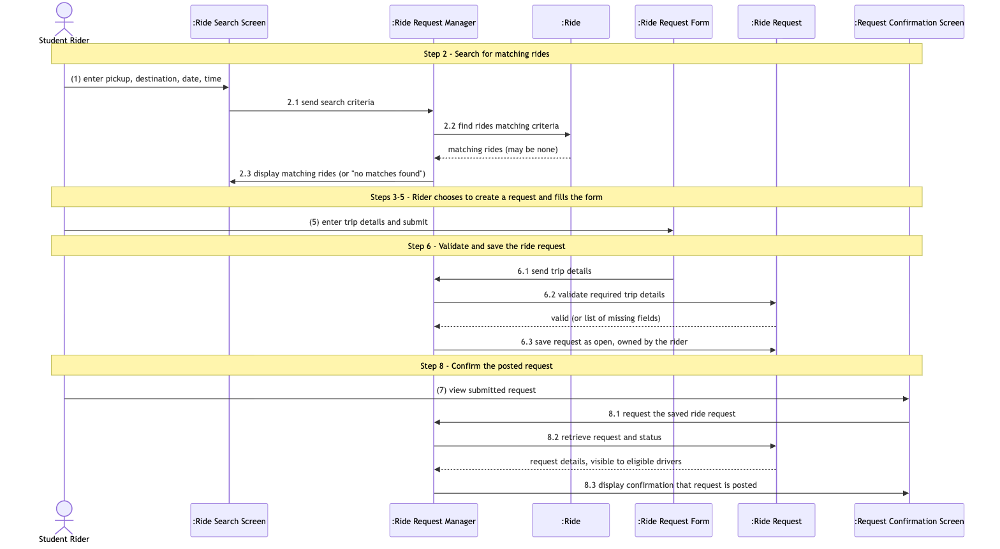
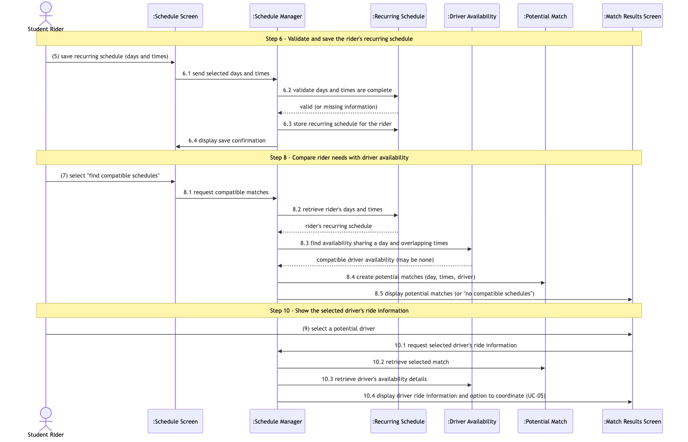

# 5.2 Object Interaction Models

## Overview

This section describes how conceptual objects interact to support the expanded use cases documented in Section 4.2.

Two use cases from Section 4.1 are analyzed: UC-03 (Search and Manage Ride Requests) and UC-04 (Manage Recurring Schedules and Find Matches). UC-04 is the most complex use case, because it compares rider needs with driver availability.

Each interaction model includes:

1. Non-trivial steps.
2. A scenario table.
3. An analysis sequence diagram.

Message numbers in each diagram match the step numbers in the scenario table (for example, message 6.2 belongs to step 6). Numbers in parentheses, such as (5), are actor inputs from the Section 4.2 main success scenario. Dashed arrows are return values and are not numbered. Editable Mermaid sources are saved next to the images in `../diagrams/`.

Conceptual classes used here (Student Rider, Ride, Ride Request, Recurring Schedule, Driver Availability, Potential Match) come from the domain model in Section 5.1.

---

## 5.2.1 UC-03 — Search and Manage Ride Requests

### (a) Non-Trivial Steps

| Step | Description | Why Object Interaction Is Required |
| :--- | :--- | :--- |
| (2) | The system searches for available rides matching the entered criteria and displays the results. | The search screen must pass the criteria to a manager that looks up Ride objects and returns the matches, or a "no matches" result (A1). |
| (6) | The system validates the information and saves the ride request. | The submitted trip details must be checked for completeness (A2) and then stored as a Ride Request owned by the rider. |
| (8) | The system displays confirmation that the request was posted and is available to eligible drivers. | The system must retrieve the saved Ride Request and its status before it can confirm that the request is posted and visible. |

### Trivial Steps

| Step | Reason It Is Trivial |
| :--- | :--- |
| (0) Display the ride search interface | Only shows a screen. No other objects are involved. |
| (1) Rider enters pickup, destination, date, and time | Actor input only. The data is used by step (2). |
| (3) Rider reviews results and chooses to create a request | Actor decision. No system objects interact. |
| (4) System displays the ride request form | Only shows a screen. No other objects are involved. |
| (5) Rider enters trip details and submits | Actor input only. The data is used by step (6). |
| (7) Rider views the submitted request | Actor action that triggers step (8). |

### (b) Scenario Table

| Step | Subject (Who Acts) | Subject Action (What It Does) | Other Data / Objects (What Is Used) | Object Acted Upon (Who Receives) |
| :--- | :--- | :--- | :--- | :--- |
| 2.1 | Ride Search Screen | Sends the search criteria | Pickup location, destination, date, time | Ride Request Manager |
| 2.2 | Ride Request Manager | Finds rides that match the criteria | Search criteria | Ride |
| 2.3 | Ride Request Manager | Displays the matching rides, or a "no matching rides found" message | List of matching rides | Ride Search Screen |
| 6.1 | Ride Request Form | Sends the submitted trip details | Pickup location, destination, date, time, seats | Ride Request Manager |
| 6.2 | Ride Request Manager | Validates that all required trip details are present | Trip details | Ride Request |
| 6.3 | Ride Request Manager | Saves the request as open and owned by the rider | Trip details, Student Rider | Ride Request |
| 8.1 | Request Confirmation Screen | Asks for the saved ride request | Request identifier | Ride Request Manager |
| 8.2 | Ride Request Manager | Retrieves the request and its status | Request identifier | Ride Request |
| 8.3 | Ride Request Manager | Displays confirmation that the request is posted and visible to eligible drivers | Request details, status | Request Confirmation Screen |

### (c) Analysis Sequence Diagram

**Figure 5.2.1:** Analysis sequence diagram for UC-03. Message numbers correspond to the scenario table. Editable source: [5.2.1_Sequence_Diagram.mmd](../diagrams/5.2.1_Sequence_Diagram.mmd).

### Interaction Objects

| Interaction Object | Responsibility |
| :--- | :--- |
| Ride Search Screen | Accepts the rider's search criteria and shows matching rides. |
| Ride Request Form | Accepts the trip details for a new ride request. |
| Request Confirmation Screen | Shows the rider that the request was posted. |
| Ride Request Manager | Coordinates searching, validating, saving, and retrieving rides and ride requests. |

---

## 5.2.2 UC-04 — Manage Recurring Schedules and Find Matches

### (a) Non-Trivial Steps

| Step | Description | Why Object Interaction Is Required |
| :--- | :--- | :--- |
| (6) | The system validates and saves the schedule, then displays confirmation. | The submitted days and times must be checked for completeness (A2) and then stored as the rider's Recurring Schedule. |
| (8) | The system compares the rider's recurring needs with saved driver availability and displays potential matches. | The rider's Recurring Schedule must be compared with Driver Availability, and the compatible results turned into Potential Matches (or "no compatible schedules", A1). |
| (10) | The system displays the selected driver's relevant ride information and an option to coordinate through UC-05. | The selected Potential Match and the driver's availability details must be retrieved before they can be shown. |

### Trivial Steps

| Step | Reason It Is Trivial |
| :--- | :--- |
| (0) Display the recurring schedule interface | Only shows a screen. No other objects are involved. |
| (1) Rider selects days of the week | Actor input only. The data is used by step (6). |
| (2) System records the days and shows time fields | Updates only the form currently on screen. Nothing is stored or exchanged with other objects. |
| (3) Rider enters times | Actor input only. The data is used by step (6). |
| (4) System displays the schedule for review | Redisplays what the rider just entered. No other objects are involved. |
| (5) Rider chooses to save | Actor action that triggers step (6). |
| (7) Rider chooses to find compatible schedules | Actor action that triggers step (8). |
| (9) Rider reviews matches and selects a driver | Actor decision that triggers step (10). |

### (b) Scenario Table

| Step | Subject (Who Acts) | Subject Action (What It Does) | Other Data / Objects (What Is Used) | Object Acted Upon (Who Receives) |
| :--- | :--- | :--- | :--- | :--- |
| 6.1 | Schedule Screen | Sends the selected days and times | Days of week, times | Schedule Manager |
| 6.2 | Schedule Manager | Validates that the days and times are complete | Days of week, times | Recurring Schedule |
| 6.3 | Schedule Manager | Stores the recurring schedule for the rider | Days of week, times, Student Rider | Recurring Schedule |
| 6.4 | Schedule Manager | Displays the save confirmation | Confirmation message | Schedule Screen |
| 8.1 | Schedule Screen | Requests compatible matches | Rider's saved schedule | Schedule Manager |
| 8.2 | Schedule Manager | Retrieves the rider's days and times | Student Rider | Recurring Schedule |
| 8.3 | Schedule Manager | Finds driver availability that shares a day and overlapping times | Rider's days and times | Driver Availability |
| 8.4 | Schedule Manager | Creates potential matches from the compatible availability | Day, times, driver | Potential Match |
| 8.5 | Schedule Manager | Displays the potential matches, or a "no compatible schedules" message | List of potential matches | Match Results Screen |
| 10.1 | Match Results Screen | Requests the selected driver's ride information | Selected match | Schedule Manager |
| 10.2 | Schedule Manager | Retrieves the selected match | Selected match | Potential Match |
| 10.3 | Schedule Manager | Retrieves the driver's availability details | Driver | Driver Availability |
| 10.4 | Schedule Manager | Displays the driver's ride information and the option to coordinate through UC-05 | Driver ride information | Match Results Screen |

### (c) Analysis Sequence Diagram

**Figure 5.2.2:** Analysis sequence diagram for UC-04. Message numbers correspond to the scenario table. Editable source: [5.2.2_Sequence_Diagram.mmd](../diagrams/5.2.2_Sequence_Diagram.mmd).

### Interaction Objects

| Interaction Object | Responsibility |
| :--- | :--- |
| Schedule Screen | Accepts the rider's days and times and shows save confirmations. |
| Match Results Screen | Shows potential matches and the selected driver's ride information. |
| Schedule Manager | Coordinates validating, storing, comparing, and retrieving schedules and matches. |
