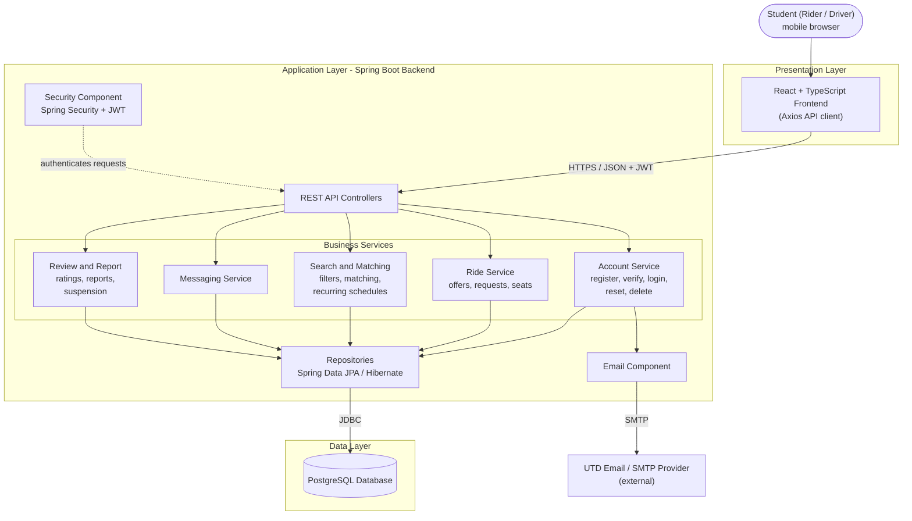

# 6.3 Component View

## Overview

This section presents the high-level components of the Comet Carpool System and describes their responsibilities, interfaces, and dependencies.

The component view shows how the system is organized to support the use cases, quality-attribute scenarios, and architectural decisions.

## Component Diagram

**Figure 6.3:** Component diagram showing system components, provided and required interfaces, and external systems.

Mermaid source (editable version of Figure 6.3)

## Component Responsibilities

| Component | Responsibility (One Sentence) | Provides | Requires | Answers To (UC / QAS / ADR) |
| :--- | :--- | :--- | :--- | :--- |
| React + TypeScript Frontend | Presents a mobile-first interface and sends user actions to the backend. | User interface for all features | REST API (Axios over HTTPS) | UC-01 to UC-07, QAS-04, QAS-06 |
| Security Component (Spring Security + JWT) | Authenticates requests and blocks unauthorized access to protected endpoints. | Authentication and authorization | Account Service (credential check) | UC-01, QAS-05 |
| REST API Controllers | Receives HTTP requests, validates input, and routes them to the correct service. | REST API | Business Services, Security Component | UC-01 to UC-07, QAS-01, QAS-05 |
| Account Service | Manages registration, UTD email verification, login, password reset, and account deletion. | Account management | Repositories, Email Component | UC-01, QAS-05, ADR-01 |
| Ride Service | Manages ride offers, ride requests, seat availability, and ride status. | Ride and request management | Repositories | UC-02, UC-03, QAS-03 |
| Search and Matching Service | Finds rides and requests that satisfy search filters and recurring schedules. | Ride search and match suggestions | Ride Service data, Repositories | UC-03, UC-04, QAS-01 |
| Messaging Service | Lets a rider and driver exchange text messages about a ride. | Messaging | Repositories | UC-05, QAS-02 |
| Review and Report Service | Stores ratings, reviews, and safety reports, and applies automatic suspension rules. | Reviews and reports | Repositories, Account Service | UC-06, UC-07, QAS-03 |
| Repositories (Spring Data JPA / Hibernate) | Reads and writes application data without exposing SQL to services. | Data access | PostgreSQL | QAS-03, ADR-01 |
| Email Component | Sends verification and password reset emails. | Email delivery | External email provider (SMTP) | UC-01, CON-01 |
| PostgreSQL Database | Stores all persistent application data. | Persistent storage | None | QAS-03 |

## Component Interactions

The components follow the layered style chosen in Section 6.2: each layer only calls the layer directly below it.

1. **Request path.** The student uses the React frontend, which calls the REST API over HTTPS using JSON and a JWT in the request header. The Security Component checks the token before the request reaches a controller.
2. **Controller to service.** Each controller passes the request to one business service (account, ride, search and matching, messaging, or review and report).
3. **Service to data.** Services read and write data only through the repositories, which talk to PostgreSQL over JDBC. Services never access the database directly.
4. **Examples by use case.**
   - Posting a ride (UC-02): Frontend, controller, Ride Service, repository, database.
   - Searching for rides (UC-03, UC-04): the Search and Matching Service applies date, time, location, and seat rules (Q10, Q11) to ride data.
   - Registering or resetting a password (UC-01): Account Service stores the user and asks the Email Component to send a verification or reset email.
   - Messaging (UC-05) and reporting (UC-07): the corresponding service stores the record, and reports can trigger suspension through the Account Service.

Interfaces are named by the service they provide, such as ride and request management or messaging, rather than by individual operations.

## External Systems

| External System | Purpose | Related Component |
| :--- | :--- | :--- |
| UTD Email / SMTP Provider | Delivers verification codes and password reset links to students' UTD email addresses. | Email Component |

The browser used by the student is the only other outside party. No payment, GPS, or class-schedule system is included, because of constraints CON-02, CON-03, and CON-04 in Section 6.1.

## Component Traceability

- **Use cases.** Every component supports at least one use case, as shown in the "Answers To" column above. Account, Ride, Search and Matching, Messaging, and Review and Report map to UC-01, UC-02 to UC-04, UC-05, and UC-06 and UC-07 respectively.
- **Quality-attribute scenarios.**
  - QAS-01 (search speed): Search and Matching Service and database.
  - QAS-02 (message delivery): Messaging Service.
  - QAS-03 (reliable saves): Repositories and PostgreSQL.
  - QAS-04 and QAS-06 (usability, responsive layout): React frontend.
  - QAS-05 (security): Security Component and REST API Controllers.
- **Architectural decisions.** ADR-01 (layered architecture, Section 6.2) explains the separation between the presentation, application, and data layers, and why services reach the database only through repositories.

## Diagram Verification

- [x] All major system components are represented.
- [x] Each component has a clearly defined responsibility.
- [x] Provided and required interfaces are identified.
- [x] External systems are shown outside the system boundary.
- [x] Every component traces to a UC, QAS, or ADR.
- [x] Interfaces are named by the services they provide rather than detailed operation signatures.
