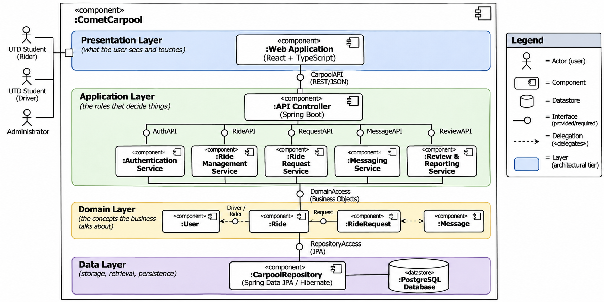

# 6.3 Component View

## Overview

This section presents the high-level components of the Comet Carpool System and describes their responsibilities, interfaces, and dependencies.

The component view shows how the system is organized to support the use cases, quality-attribute scenarios, and architectural decisions.

## Component Diagram

**Figure 6.3:** Component diagram showing system components, provided and required interfaces, and external systems.

Mermaid source (editable version of Figure 6.3)

## Component Responsibilities

| Component | Responsibility (One Sentence) | Provides | Requires | Answers To (UC / QAS / ADR) |
| :--- | :--- | :--- | :--- | :--- |
| Web Application | Provides the user interface for students and admins to search rides, post rides, submit requests, manage schedules and communicate | User Interface | CarpoolAPI(REST/JSON) | UC-02/03/04  QAS-04/06 |
| API Controller | Recieves REST requests from the web application and routes them to the backend services related to it | CarpoolAPI(REST/JSON) | AuthAPI, RideAPI, RequestAPI, MessageAPI, ReviewAPI | UC-02/03/04  QAS-01/05 |
| Authentication Services | Manages user registration, login, and authorization for protected system features | AuthAPI | DomainAccess | UC-02/03/04  QAS-05 |
| Ride Management Services | Manages ride postings, ride searches, ride updates, cancellations and recurring ride functionality | RideAPI | DomainAccess | UC-02/03/04  QAS-01/03 |
| Ride Request Service | Processes ride requests including submission, validation, cancellation, and request management | RequestAPI | DomainAccess | UC-03  QAS-03/04 |
| Messaging Service | Manages sending, receiving and retrieval of messages between riders and drivers | MessageAPI | DomainAccess | QAS-02/05 |
| Review & Reporting Service | Manages user reviews, ratings, and report submissions | ReviewAPI | DomainAccess | QAS-03/05 |
| Domain Model | Represents the core business concepts and rules associated with users, rides, ride requests, messages, reviews, reports, and recurring schedules | DomainAccess | RepositoryAccess | UC-02/03/04 |
| Carpool Repository | Provides persistent data storage and retrieval using Spring Data JPA and Hibernate | RepositoryAccess | PostgreSQL, Database (SQL) | QAS-01/03 |
| PostgreSQL Database | Stores user accounts, ride postings, ride requests, recurring schedules, messages and other app data | SQL Data Storage | None | QAS-01/02/03 |
