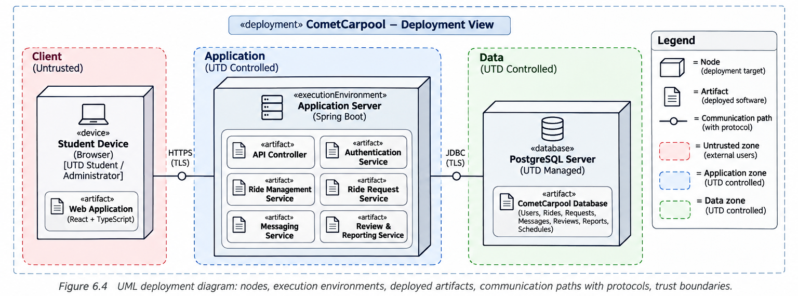

# 6.4 Deployment View

## Overview

This section describes how the Comet Carpool System's software components are deployed across physical or virtual computing environments.

The deployment view identifies execution environments, deployed artifacts, communication protocols, and trust boundaries.

## Deployment Diagram

**Figure 6.4:** UML deployment diagram showing nodes, execution environments, deployed artifacts, communication paths, protocols, and trust boundaries.

## Deployment Nodes

| Node | What Runs on It (Artifacts, Components) | Communicates With (Protocol) | Trust Zone |
| :--- | :--- | :--- | :--- |
| Student Device/Web Bowser | React + TypeScript Web Application | Backend Server (HTTPS/REST/JSON) | External / Untrusted Client |
| Application Server | Spring Boot REST API, Authentication, Ride Management, Ride Requests, Messaging, Review & Reporting, Domain Model | Browser (HTTPS), Database server | Trusted Application Zone |
| Database Server | PostgreSQL Database and persisted application data. Repo's run on the application server | Application server (PostgreSQL protocol over TCP) | Restricted Data Zone |
